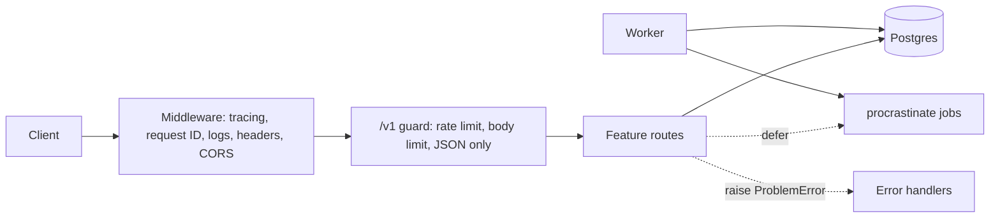

# Architecture

Paths are under `src/app/`.

| Layer | Path | Does | Must not |
|---|---|---|---|
| Entry point | `cli.py`, `asgi.py` | Runs serve, migrate, seed, worker, and healthcheck | Hold business logic |
| App | `main.py`, `middleware.py`, `dependencies.py` | Wires middleware, error handlers, routes, and each request's database session | Touch tables directly |
| Features | `features/*/routes.py` | Define the HTTP contract, validate input, and run queries | Import another feature, except `auth.dependencies` |
| Jobs | `jobs.py`, `email.py` | Background tasks and their schedules | Import a feature or FastAPI, even through another module |
| Platform | `problems.py`, `ratelimit.py`, `security.py`, `ids.py`, `config.py` | Errors, limits, hashing, IDs, and settings | Import a feature |
| Database | `db.py`, `migrations/` | Tables, the engine, and migrations | Import a feature or FastAPI |

`tests/unit/test_architecture.py` fails the build when an import breaks these rules. It finds every folder in `features/` on its own, and Ruff bans relative imports so it sees each one.

## Key behaviors

- **Contract:** Pydantic models generate `openapi.json`, and a test fails if the committed file is out of date. `clients/python` is generated from it.
- **Errors:** every failure is RFC 9457 Problem Details. Unexpected errors are logged and recorded on the trace, and the client only sees a request ID.
- **Authorization:** every note query filters by the caller's user ID, so another user's note looks like it doesn't exist.
- **Concurrency:** updates need an `If-Match` version, and the check happens inside the `UPDATE` statement.
- **Idempotency:** the key and the note are written in one transaction. A concurrent duplicate waits for the first to commit, then replays it.
- **Jobs:** the API defers jobs into Postgres in the request's transaction, so a job exists only if its data does. The worker runs them with retries. Jobs can run more than once, so each one is safe to retry.
- **Database roles:** the API and worker connect as `api_app`, which can read and write rows but can't change the schema. Migrations run as `api_owner`.
