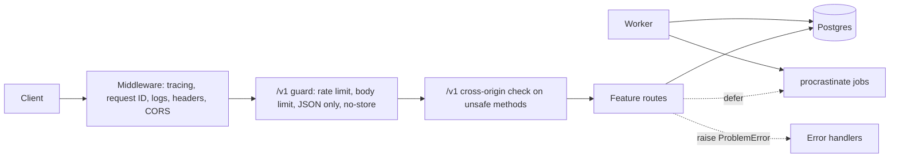

# Architecture

Paths are under `src/app/`.

| Layer | Path | Does | Must not |
|---|---|---|---|
| Entry point | `cli.py`, `asgi.py`, `healthcheck.py` | Runs serve, migrate, seed, worker, and healthcheck | Hold business logic |
| App | `main.py`, `middleware.py`, `dependencies.py`, `openapi.py`, `docs.py` | Wires middleware, error handlers, routes, each request's database session, the OpenAPI document, and `/docs` | Touch tables directly |
| Features | `features/*/routes.py` | Define the HTTP contract, validate input, and run queries | Import another feature, except `auth.dependencies` |
| Jobs | `jobs.py`, `email.py` | Background tasks and their schedules | Import a feature or FastAPI, even through another module |
| Platform | `problems.py`, `ratelimit.py`, `security.py`, `ids.py`, `config.py`, `telemetry.py`, `log.py` | Errors, limits, hashing, IDs, settings, telemetry, and logs | Import a feature |
| Database | `db.py`, `migrations/` | Tables, the engine, and migrations | Import a feature or FastAPI |

`tests/unit/test_architecture.py` fails the build when an import breaks these rules. It finds every folder in `features/` on its own, and Ruff bans relative imports so it sees each one.

## Key behaviors

- **Contract:** Pydantic models generate `openapi.json`, and a test fails if the committed file is out of date. `openapi.py` adds the problems and headers middleware sends, as shared components, and a test sends each operation what middleware rejects to check they're documented. `clients/python` is generated from it.
- **Rate limits:** every `/v1` request counts against the client network's global limit, registration and login against a stricter one, and failed logins against a per-email one. Responses carry `RateLimit-Policy` and `RateLimit`, and every `/v1` response has `Cache-Control: no-store`. See [Read the rate limits](operations.md#read-the-rate-limits).
- **Headers:** every response has a request ID and security headers, including `Content-Security-Policy: default-src 'none'; frame-ancestors 'none'`. `/docs`, when turned on, gets a CSP that allows only its own scripts and styles.
- **Errors:** every failure is RFC 9457 Problem Details. Unexpected errors are logged and recorded on the trace, and the client only sees a request ID.
- **Authentication:** a bearer token in `Authorization`, or else the `__Host-session` cookie. A request with an `Authorization` header never falls back to the cookie.
- **Cross-origin protection:** on `/v1`, a request that isn't `GET`, `HEAD`, or `OPTIONS` gets 403 when `Sec-Fetch-Site` or `Origin` shows it came from another origin that isn't in `CORS_ORIGINS`. It's the same check as Go's `CrossOriginProtection`.
- **Authorization:** every note query filters by the caller's user ID, so another user's note looks like it doesn't exist.
- **Concurrency:** updates need `If-Match` with a strong ETag from a read, or `*` for any version, and the check happens inside the `UPDATE` statement. Weak ETags never match, as RFC 9110 says.
- **Idempotency:** the key and the note are written in one transaction. A concurrent duplicate waits for the first to commit, then replays it. Keys are scoped to the user and the endpoint, and expire after 24 hours, after which the key creates a new note. The key's fingerprint hashes the method, path, and canonical JSON of the whole validated body, so a new field is covered without code changes.
- **Jobs:** the API defers jobs into Postgres in the request's transaction, so a job exists only if its data does. The worker runs them with retries, and puts back jobs whose worker died. Jobs can run more than once, so each one is safe to retry.
- **Shutdown:** on `SIGTERM`, the API fails `/readyz` while it keeps serving for `SHUTDOWN_DRAIN_SECONDS`, then finishes in-flight requests. See [Drain on shutdown](deploy.md#drain-on-shutdown).
- **Database roles:** the API and worker connect as `api_app`, which can read and write rows but can't change the schema. Migrations run as `api_owner`.
